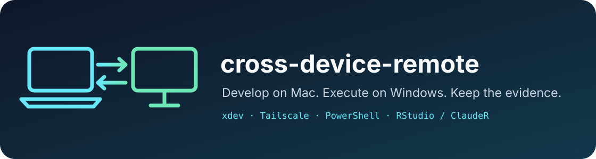
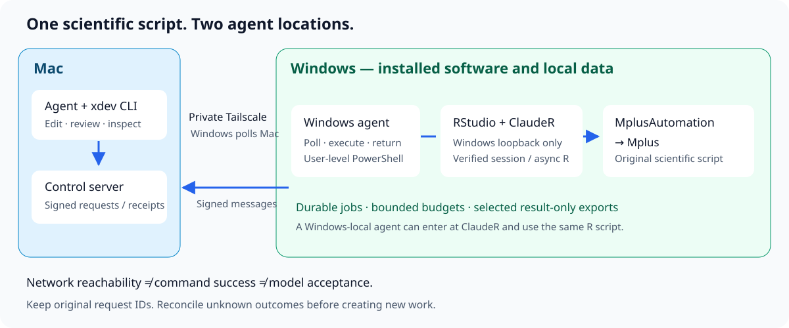

<p align="center"></p>

# cross-device-remote · xdev

**English** · [繁體中文](README.zh-TW.md)

Use your Mac agent to run authorized work on a Windows computer, keep durable request IDs, and bring back verified results. `xdev` provides one CLI for short PowerShell commands, background tasks, file transfer and Windows RStudio/ClaudeR workflows over a private network such as Tailscale.

Keep development and review on the Mac while Windows runs software and data that already live there. A Windows-local agent can use the same RStudio → R → MplusAutomation → Mplus scientific scripts; changing where the agent runs does not change the research design.

## What is included

- A Python Mac controller and a user-level Windows PowerShell worker.
- Signed control messages, stable request IDs, late-result recovery and file SHA-256 checks.
- A session-bound ClaudeR entry with separate execute, submit, poll and result operations.
- A shared `SKILL.md` and install links for Codex, Claude Code, Gemini and Antigravity. Other command-capable agents can read the same skill and run the CLI explicitly.
- English and Traditional Chinese setup, architecture, recovery and validation guides; reusable operational recipes and original SVG artwork.

The originating deployment has run real research batches through Windows RStudio/ClaudeR and MplusAutomation. **The first public package still needs fresh-machine Windows validation.** Installed links do not establish automatic loading by every agent, and local tests do not establish remote scientific acceptance. See the [validation contract](docs/validation.md).

## Install

On the Mac:

```sh
git clone https://github.com/lzhs1995/cross-device-remote.git
cd cross-device-remote
python3 scripts/check.py
python3 scripts/install.py --agents codex claude gemini antigravity
export PATH="$HOME/.agents/skills/cross-device-remote/scripts:$PATH"
```

This installs links and creates a private sample configuration only when absent. It does not start services or replace existing installations by default. Keep this checkout in place because the links point to it.

Next, follow the [complete pairing guide](docs/installation.md): initialize private Mac state, set your actual Tailscale binding and Windows allowlist, transfer the pairing secret privately, and install a fresh Windows worker with `windows/install.ps1`. The sample configuration listens only on loopback until you configure it. Existing workers must retain their original state and recovery path.

Windows installer entry, from the Windows checkout:

```powershell
powershell -NoProfile -ExecutionPolicy Bypass -File .\windows\install.ps1 -Server 'http://<MAC_TAILSCALE_IP>:18092' -SecretFile 'C:\private\xdev-secret' -AutoStart -Start
```

Replace the address and private file path. `-AutoStart` installs user-level tasks; `-Start` starts now. No software licenses, R packages or credentials are shipped here.

## First verified command

After pairing and starting the Windows worker:

```sh
xdev serve
xdev health
xdev run -c '[DateTime]::UtcNow.ToString("o")' --timeout 20
```

Keep the returned request ID. If the wait expires, use `xdev result ID`; do not submit the command again. Require a fresh Windows poll and a new command receipt before claiming that the command channel is working. An old `running` record alone is not that evidence.

## Execution routes

| Task | Entry | Boundary |
| --- | --- | --- |
| Short PowerShell | `xdev run check.ps1` | Holds the shared command queue; keep it short |
| Background PowerShell | `xdev detach unique-name job.ps1` | Rejoin with the same name using `tail` or `wait` |
| Windows RStudio / ClaudeR | `xdev rstudio bind`, `execute`, `submit`, `poll`, `result` | Bind a real session; reuse the original request/job ID |
| Standalone R script | `xdev rscript analysis.R --out ./results/run` | Separate route from RStudio; collects the whole work directory |
| Direct Mplus input | `xdev mplus model.inp --input synthetic.dat --out ./results/run` | Separate route from MplusAutomation; requires installed Mplus |
| Files | `xdev push`, `pull`, `pull-dir` | Checks bytes; directory collection does not filter private inputs |

When RStudio/ClaudeR is required, use the [full RStudio recipe](recipes/windows-rstudio-clauder.en.md). Do not substitute a successful Rscript or direct Mplus run. The same approved scientific script belongs in both the local-Windows and Mac-remote workflow.

`wait`, `rscript` and `mplus --max` bound the Mac wait, not the Windows model runtime. A scientific worker must enforce its own finite engine budget. `run --timeout` has different semantics and can terminate its command process tree.

## Architecture



Windows polls the Mac for signed commands. For RStudio work, the Windows command calls ClaudeR on Windows loopback; the RStudio session launches asynchronous R work, which invokes MplusAutomation and Mplus. Data can stay on Windows while selected results return to the Mac.

Transport, session management and scientific acceptance have different owners:

- **cross-device-remote:** private transport, request state, file transfer and operational recovery.
- **[clauder-rstudio-workbench](https://github.com/lzhs1995/clauder-rstudio-workbench):** ClaudeR installation, RStudio session behavior and native MCP checks.
- **mplusautomation-guide, in that repository:** scientific R drivers, model budgets, convergence and independent result validation.

Read the [architecture](docs/architecture.md) for the two agent locations and identity model.

## Reliable and efficient operation

Prepare scripts before requesting a shared Windows slot. Submit one useful approved batch, let Windows schedule its members, and use one low-frequency observer of the original job. When a slot is granted, start the already prepared batch promptly rather than doing new engineering in the window.

Separate network reachability, command acceptance, RStudio identity, engine execution and scientific success. Preserve UNKNOWN results and spent budgets. A timeout is a reason to reconcile the original request, not replay it. Do not claim exactly-once behavior through every crash or power failure.

For restricted data, create a separate result-only export on Windows and verify its exact file set before and after collection. `pull-dir`, `rscript` and `mplus` can otherwise return input copies. Check Mac free space and the project's transfer cap before pulling; check Windows memory and disk separately before estimation.

HMAC authenticates messages but does not encrypt them. Use a private Tailscale path, bind the server to the intended interface and allow only intended peers. Keep real addresses, tailnet names, state, secrets and private research evidence outside this repository. See [installation](docs/installation.md) and [recovery](docs/recovery.md).

## Documentation

| Topic | English | 繁體中文 |
| --- | --- | --- |
| Installation and agent entries | [Guide](docs/installation.md) | [指南](docs/installation.zh-TW.md) |
| Architecture and responsibilities | [Guide](docs/architecture.md) | [指南](docs/architecture.zh-TW.md) |
| Recovery and resource limits | [Guide](docs/recovery.md) | [指南](docs/recovery.zh-TW.md) |
| Validation and honest performance claims | [Guide](docs/validation.md) | [指南](docs/validation.zh-TW.md) |
| RStudio / ClaudeR / MplusAutomation | [Recipe](recipes/windows-rstudio-clauder.en.md) | [配方](recipes/windows-rstudio-clauder.md) |
| Research batch continuation | [Recipe](recipes/research-batches.en.md) | [配方](recipes/pp-lgcm-mplus-continuation.md) |

Additional Traditional Chinese recipes: [Rscript](recipes/windows-r.md), [direct Mplus](recipes/windows-mplus.md), [MplusAutomation](recipes/windows-mplusautomation.md), [PowerShell/WSL/shared queues](recipes/windows-wsl-ops-lessons.md), and [migration/disk/verification](recipes/mac-restore-and-remote-acceptance-lessons.md).

## Development and license

Run `python3 scripts/check.py` for local checks. Read `scripts/selftest.sh` before using it: it is a connected check that creates remote synthetic tasks and files. Do not run engine tests without an approved window and finite budget.

Source and original artwork use the repository's [MIT license](LICENSE). Integrated software retains its own license and installation requirements. Contributions should preserve IDs and recovery semantics, avoid private deployment details, and state the exact scope of validation.
