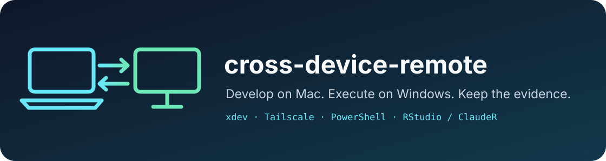
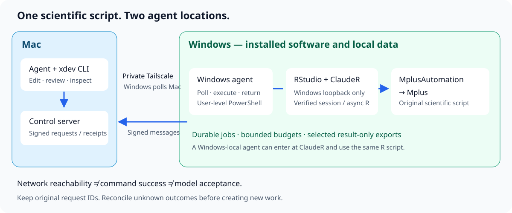

<p align="center"></p>

# cross-device-remote · xdev

[English](README.md) · **繁體中文**

讓 Mac 上的 agent 在 Windows 電腦執行已授權工作，保留持久請求 ID，並取回經校驗的結果。`xdev` 提供統一 CLI，透過 Tailscale 等私有網路執行短 PowerShell、背景工作、檔案傳輸及 Windows RStudio／ClaudeR 工作流。

Mac 負責開發與審查，Windows 執行原本安裝在那裡的軟體並保留資料。Windows 本機 agent 也能使用同一份 RStudio → R → MplusAutomation → Mplus 科學腳本；agent 所在機器改變，不應改變研究設計。

## 套件內容

- Python Mac 控制器與使用者層 Windows PowerShell worker。
- 簽章控制訊息、固定請求 ID、遲到結果接回及檔案 SHA-256 校驗。
- 綁定工作階段的 ClaudeR 入口，分開執行 execute、submit、poll 與 result。
- 共用 `SKILL.md`，以及 Codex、Claude Code、Gemini、Antigravity 安裝連結；其他能執行命令的 agent 也可明確讀取同一 skill 並呼叫 CLI。
- 完整英文／繁體中文安裝、架構、恢復、驗收指南，可重用操作配方及原創 SVG 配圖。

來源部署已經由 Windows RStudio／ClaudeR 與 MplusAutomation 執行真實科研批次。**首個公開套件仍需新機 Windows 驗收。** 安裝連結不代表每個 agent 都已自動載入；本機測試也不等於遠端科學驗收。詳見 [驗收契約](docs/validation.zh-TW.md)。

## 安裝

在 Mac 執行：

```sh
git clone https://github.com/lzhs1995/cross-device-remote.git
cd cross-device-remote
python3 scripts/check.py
python3 scripts/install.py --agents codex claude gemini antigravity
export PATH="$HOME/.agents/skills/cross-device-remote/scripts:$PATH"
```

安裝器建立連結，並只在設定不存在時建立私有範例設定；預設不啟動服務、不替換既有安裝。連結指向此 checkout，請保留其位置。

接著依 [完整配對指南](docs/installation.zh-TW.md) 初始化 Mac 私有 state、設定真實 Tailscale 綁定位址與 Windows 允許清單，私下傳送配對密鑰，再用 `windows/install.ps1` 安裝全新 Windows worker。範例設定在修改前僅監聽 loopback。既有 worker 必須保留原 state 與恢復路徑。

Windows 安裝入口，在 Windows checkout 執行：

```powershell
powershell -NoProfile -ExecutionPolicy Bypass -File .\windows\install.ps1 -Server 'http://<MAC_TAILSCALE_IP>:18092' -SecretFile 'C:\private\xdev-secret' -AutoStart -Start
```

替換位址與私有檔案路徑。`-AutoStart` 安裝使用者層排程，`-Start` 立即啟動。本套件不提供軟體授權、R 套件或憑據。

## 第一個可核對的命令

完成配對並啟動 Windows worker 後：

```sh
xdev serve
xdev health
xdev run -c '[DateTime]::UtcNow.ToString("o")' --timeout 20
```

保留回傳的請求 ID。等待到期時用 `xdev result ID`，不要再提交一次。宣稱命令通道可用前，必須看到新鮮 Windows 輪詢及新命令回執；舊 `running` 記錄本身不是這項證據。

## 執行路線

| 任務 | 入口 | 邊界 |
| --- | --- | --- |
| 短 PowerShell | `xdev run check.ps1` | 占用共用命令佇列，保持短小 |
| 背景 PowerShell | `xdev detach unique-name job.ps1` | 沿同名工作以 `tail` 或 `wait` 接回 |
| Windows RStudio／ClaudeR | `xdev rstudio bind`、`execute`、`submit`、`poll`、`result` | 綁定真實工作階段，沿原 request／job ID |
| 獨立 R 腳本 | `xdev rscript analysis.R --out ./results/run` | 與 RStudio 不同路線，會取回整個工作目錄 |
| 直接 Mplus 輸入 | `xdev mplus model.inp --input synthetic.dat --out ./results/run` | 與 MplusAutomation 不同路線，需已安裝 Mplus |
| 檔案 | `xdev push`、`pull`、`pull-dir` | 核位元組；目錄取回不會篩掉私有輸入 |

指定 RStudio／ClaudeR 時，使用 [完整 RStudio 配方](recipes/windows-rstudio-clauder.md)，不能以成功的 Rscript 或直接 Mplus 代替。Windows 本機與 Mac 遠端工作流應使用同一份已批准科學腳本。

`wait`、`rscript` 與 `mplus --max` 限制 Mac 等待，不是 Windows 模型執行時間。科學 worker 必須自行遵守有限引擎預算；`run --timeout` 語義不同，可能終止該命令的程序樹。

## 架構



Windows 輪詢 Mac 領取簽章命令。RStudio 工作由 Windows 命令呼叫本機 loopback 上的 ClaudeR；RStudio 工作階段啟動非同步 R，再呼叫 MplusAutomation 與 Mplus。資料可留在 Windows，僅把選定結果帶回 Mac。

傳輸、工作階段管理與科學驗收各有維護範圍：

- **cross-device-remote：** 私有傳輸、請求狀態、檔案傳送與操作層恢復。
- **[clauder-rstudio-workbench](https://github.com/lzhs1995/clauder-rstudio-workbench)：** ClaudeR 安裝、RStudio 工作階段行為與原生 MCP 檢查。
- **該倉庫中的 mplusautomation-guide：** 科學 R driver、模型預算、收斂與獨立結果驗收。

兩種 agent 位置及身分模型詳見 [架構說明](docs/architecture.zh-TW.md)。

## 可靠性與效率

先準備腳本，再申請共用 Windows 窗口。一次提交有用的已批准批次，由 Windows 排程成員，Mac 僅保留一個沿原 job 的低頻觀察器。獲窗後立即啟動已備批次，不在窗口內臨時展開新工程。

網路可達、命令受理、RStudio 身分、引擎執行與科學成功分別判斷。保留 UNKNOWN 與已用預算；超時應接回原請求，不能重放。不要宣稱所有崩潰或斷電後都恰好執行一次。

限制外流資料使用 Windows 僅結果匯出，取回前後核精確檔案集合。`pull-dir`、`rscript`、`mplus` 否則可能帶回輸入副本。取回前查 Mac 空間與專案傳輸上限；估計前另查 Windows 記憶體與磁碟。

HMAC 驗證訊息但不加密。請使用私有 Tailscale 路徑，服務綁定指定介面並只允許指定對端。真實位址、tailnet 名稱、state、密鑰及私有科研證據不進本倉庫。詳見 [安裝](docs/installation.zh-TW.md) 與 [恢復](docs/recovery.zh-TW.md)。

## 文檔索引

| 主題 | English | 繁體中文 |
| --- | --- | --- |
| 安裝與 agent 入口 | [Guide](docs/installation.md) | [指南](docs/installation.zh-TW.md) |
| 架構與責任 | [Guide](docs/architecture.md) | [指南](docs/architecture.zh-TW.md) |
| 恢復與資源限制 | [Guide](docs/recovery.md) | [指南](docs/recovery.zh-TW.md) |
| 驗收與效率宣稱 | [Guide](docs/validation.md) | [指南](docs/validation.zh-TW.md) |
| RStudio／ClaudeR／MplusAutomation | [Recipe](recipes/windows-rstudio-clauder.en.md) | [配方](recipes/windows-rstudio-clauder.md) |
| 研究批次接續 | [Recipe](recipes/research-batches.en.md) | [配方](recipes/pp-lgcm-mplus-continuation.md) |

其他繁體配方：[Rscript](recipes/windows-r.md)、[直接 Mplus](recipes/windows-mplus.md)、[MplusAutomation](recipes/windows-mplusautomation.md)、[PowerShell／WSL／共用佇列](recipes/windows-wsl-ops-lessons.md)、[遷移／磁碟／驗收](recipes/mac-restore-and-remote-acceptance-lessons.md)。

## 開發與授權

本機檢查執行 `python3 scripts/check.py`。使用 `scripts/selftest.sh` 前先閱讀：它會建立遠端合成工作與檔案。引擎測試必須有已批准窗口及有限預算。

原始碼與原創配圖採用本倉庫 [MIT 授權](LICENSE)；整合軟體各自保留授權與安裝要求。貢獻請保留 ID 與恢復語義、不攜帶私有部署資訊，並明確記錄驗收範圍。
