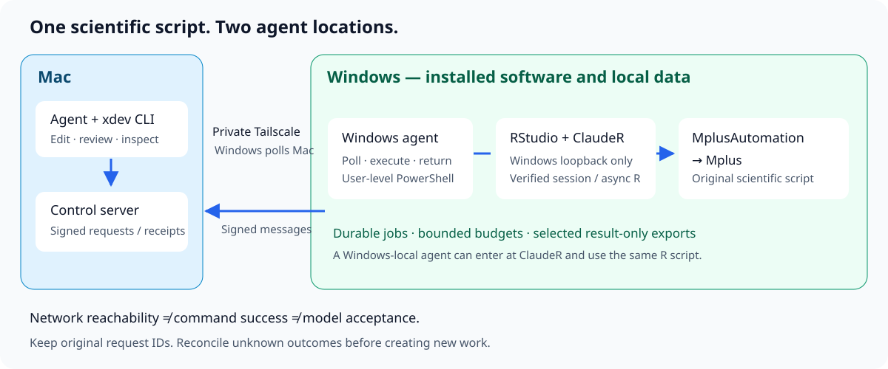

# Architecture

[繁體中文](architecture.zh-TW.md) · [Project](../README.md)

## Responsibilities

| Layer | Responsibility | What it does not establish |
| --- | --- | --- |
| Agent on the Mac | Edit, review, submit a prepared request, inspect durable results | That a queued request ran |
| `xdev` and the Mac server | Signed control messages, request IDs, file transport, checksums | Scientific validity or universal exactly-once execution |
| Windows agent | Poll the configured server, run authorized PowerShell, return results | That a background model has completed |
| Windows RStudio + ClaudeR | Execute in a verified R session; start and observe asynchronous R work | That every member of a research batch passed |
| R + MplusAutomation + Mplus | Run the original scientific script and save model evidence | That results have been independently checked or collected |
| Domain workflow | Budgets, model design, convergence checks, result-only export, independent verification | Transport health |

The Windows agent initiates the control connection to the Mac. The Mac does not expose Windows RStudio directly: `xdev rstudio` sends a short Windows command that calls ClaudeR on Windows loopback. A discovery token, when available, is read on Windows and used there.

The controller and Windows agent authenticate messages with a shared secret. HMAC authenticates messages; it does not encrypt their contents. Use a private Tailscale path or another trusted private transport. The default sample configuration listens locally until the owner sets its trusted interface and allowlist. Do not expose the server to the public Internet.

## One scientific workflow, two agent locations

**Agent on Windows:** Windows agent → local ClaudeR/RStudio → R → MplusAutomation → Mplus.

**Agent on Mac:** Mac agent → xdev → Windows agent → Windows loopback ClaudeR/RStudio → the same R script → MplusAutomation → Mplus.

The domain script, model specification, package requirements, time budget, and result checks stay the same. Use [clauder-rstudio-workbench](https://github.com/lzhs1995/clauder-rstudio-workbench) for ClaudeR installation and session semantics, and its `mplusautomation-guide` skill for scientific execution and validation. This repository owns transport and operational recovery.

`xdev rscript` and `xdev mplus` are separate supported execution routes. They are appropriate when the task permits them. They cannot serve as evidence that a requested RStudio/ClaudeR route was used.

## State and recovery

Keep three identities separate:

1. **Transport request ID:** the short Windows command and its result.
2. **Named detached task or ClaudeR job ID:** the longer running work.
3. **Scientific member ID:** one model, its input hash, output, budget, and terminal state.

A lost transport response can coexist with a completed model. Read original evidence before deciding whether new work is needed. Local request state prevents routine duplicate submission; it is not proof of exactly-once behavior through every crash, sleep, or power failure.

`run` holds the shared command queue. `detach` and ClaudeR asynchronous work release that queue after launch. Queue availability does not imply that Mplus is idle. Conversely, old dispatched IDs without a returned receipt do not alone establish that a process is still alive.

## Efficient use

Prepare and validate scripts on the Mac before taking a Windows execution window. Transfer code once, reuse permitted data on Windows, and let one Windows worker process the approved batch. Collect a small result-only export after verification. Keep one low-frequency observer of the original job rather than repeatedly reconnecting or submitting tiny full-roundtrip jobs.

A shared-window grant should trigger the already prepared submission promptly. Bind the grant to the approved plan, script hashes, owner, and budget; persist a claim before submission, and check expiry again when Windows enters the R code. A task-specific grant watcher is a domain integration, not a built-in `xdev` scheduler.
