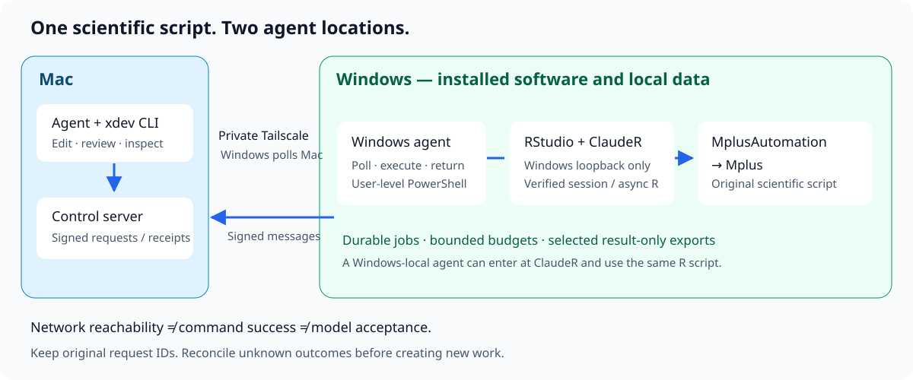

# Architecture

[繁體中文](architecture.zh-TW.md) · [Project](../README.md)

## Responsibilities

| Layer | Responsibility | What it does not establish |
| --- | --- | --- |
| Agent on the Mac | Edit, review, submit a prepared request, inspect durable results | That a queued request ran |
| `xdev` and the Mac server | Signed control messages, request IDs, file transport, checksums | Scientific validity or universal exactly-once execution |
| Windows agent | Poll the configured server, run authorized PowerShell, return results | That a background model has completed |
| Windows RStudio + ClaudeR | Execute in a verified R session; start and observe asynchronous R work | That every member of a research batch passed |
| R + MplusAutomation + Mplus | Run the original scientific script and save model evidence | That results have been independently checked or collected |
| Domain workflow | Budgets, model design, convergence checks, result-only export, independent verification | Transport health |
| Candidate fanout coordinator | Pin independent members, submit async jobs and aggregate original receipts | Atomic host admission, native MCP loading or scientific merge |
| Host owner's `HostReservations` | Shared admission across queues for RAM, commit, threads and per-volume growth | Scientific acceptance |

The Windows agent initiates the control connection to the Mac. The Mac does not expose Windows RStudio directly: `xdev rstudio` sends a short Windows command that calls ClaudeR on Windows loopback. A discovery token, when available, is read on Windows and used there.

The controller and Windows agent authenticate messages with a shared secret. HMAC authenticates messages; it does not encrypt their contents. Use a private Tailscale path or another trusted private transport. The default sample configuration listens locally until the owner sets its trusted interface and allowlist. Do not expose the server to the public Internet.

## One scientific workflow, two agent locations

**Agent on Windows:** Windows agent → local ClaudeR/RStudio → R → MplusAutomation → Mplus.

**Agent on Mac:** Mac agent → xdev → Windows agent → Windows loopback ClaudeR/RStudio → the same R script → MplusAutomation → Mplus.

The domain script, model specification, package requirements, time budget, and result checks stay the same. Use [clauder-rstudio-workbench](https://github.com/lzhs1995/clauder-rstudio-workbench) for ClaudeR installation and session semantics, and its `mplusautomation-guide` skill for scientific execution and validation. This repository owns transport and operational recovery.

`xdev rscript` and `xdev mplus` are separate supported execution routes. They are appropriate when the task permits them. They cannot serve as evidence that a requested RStudio/ClaudeR route was used.

## State and recovery

Keep three identities separate:

1. **Transport request ID:** the short Windows command and its result.
2. **Named detached task or ClaudeR job ID:** the longer running work.
3. **Scientific member ID:** one model, its input hash, output, budget, and terminal state.

A lost transport response can coexist with a completed model. Read original evidence before deciding whether new work is needed. Local request state prevents routine duplicate submission; it is not proof of exactly-once behavior through every crash, sleep, or power failure.

`run` holds the shared command queue. `detach` and ClaudeR asynchronous work release that queue after launch. Queue availability does not imply that Mplus is idle. Conversely, old dispatched IDs without a returned receipt do not alone establish that a process is still alive.

Candidate named tasks add `task-submit`, `task-status` and `task-collect`: submit independent children before waiting, then join their original names. Each child receives a unique cwd and `TMP`/`TEMP`. RStudio fanout instead preserves the required RStudio → asynchronous R → MplusAutomation route; its state namespace is `<binding-state>/fanout/<run-id>/`. The wrapper sets worker-local cwd and temporary environment, but does not relocate an already created callr R process's `tempdir()`.

The separate control candidate uses wire version `xdev-control/1`, its own server, SQLite state and worker. It is invoked as `python3 scripts/xdev_control.py`, not by repointing the live legacy worker. It negotiates capabilities, persists claim-before-start, keeps serial barriers and allows explicit independent jobs with disjoint resource keys. UNKNOWN retains its reservations. It never migrates legacy queue cursors. [Commands and exact contracts](concurrency.md) distinguish this candidate from installation and live acceptance.

## Session ordering and host capacity

One mutable Stata session needs ordered access to commands, macros, returned results, log handles and cwd. Stata frames allow multiple datasets; they do not create independent interpreters. Lease the bound session/port, not the entire host. Independent sessions still honor their original Stata engine limit, which does not become a Mplus limit.

Reuse one host-wide `HostReservations` authority across all queues. Admit against available physical RAM bytes and system commit headroom separately, plus all process/thread budgets and output/scratch growth on each volume. Include unstarted reservations and running members' remaining growth. Neither a memory percentage nor current single-process usage proves four-model capacity. Original caps, `apim_v2` cap-1/cap-2 and foreground-only contracts remain attached to their existing runs.

Fanout pins an external grant and checks its fields/expiry, but explicitly reports `capacity_scope: BATCH_ONLY` and `external_host_admission_enforced_by_xdev: false`. It does not implement atomic host reservations. Resource-key exclusion in the new control channel is also distinct from host memory admission. A per-run lock must never be presented as either one.

## Efficient use

Prepare and validate scripts on the Mac before taking a Windows execution window. Transfer code once, reuse permitted read-only inputs, and submit approved independent R workers before waiting for them to finish. Keep one aggregate observer of original job IDs. Collect a small result-only export after domain verification; `fanout-merge` merges lifecycle receipts only and leaves scientific acceptance `NOT_EVALUATED`.

A shared-window grant should trigger the already prepared submission promptly. Bind the grant to the approved plan, script hashes, owner, and budget; persist a claim before submission, and check expiry again when Windows enters the R code. A task-specific grant watcher is a domain integration, not a built-in `xdev` scheduler.

Candidate code and offline checks do not prove real parallel Mplus execution. Require overlapping real PID/birth intervals and original model terminals. A short process may exit before `MainModule` inspection; missing module information does not imply it is live. Measure intervals using a local monotonic clock; cross-host wall-clock differences need a skew bound and cannot promise sub-two-second latency. A speedup requires matched serial/parallel runs and numerical agreement.
