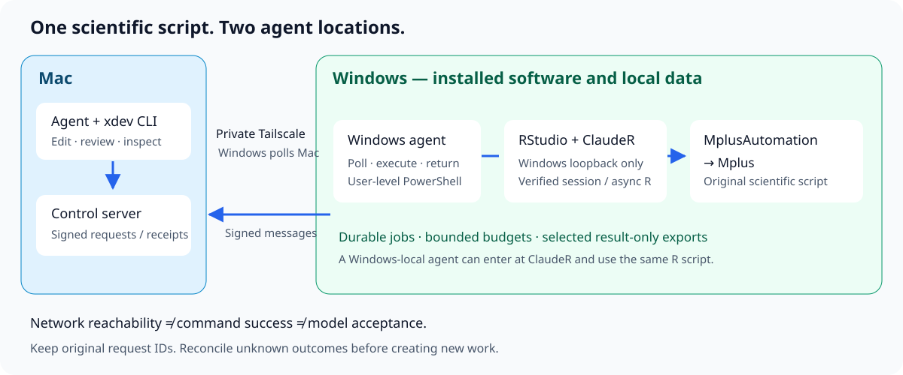

# 架構與責任

[English](architecture.md) · [專案首頁](../README.zh-TW.md)

## 各層負責什麼

| 層次 | 責任 | 不能據此證明的事 |
| --- | --- | --- |
| Mac 上的 agent | 編輯、審查、提交已準備好的請求、讀取持久結果 | 已排隊的請求真的執行過 |
| `xdev` 與 Mac 服務 | 簽章控制訊息、請求 ID、檔案傳輸、雜湊校驗 | 科學結論正確，或所有故障下都恰好執行一次 |
| Windows agent | 輪詢已設定的服務、執行已授權 PowerShell、回傳結果 | 背景模型已經結束 |
| Windows RStudio + ClaudeR | 在已核身分的 R 工作階段中執行，啟動及觀察非同步 R 工作 | 整批模型全部通過 |
| R + MplusAutomation + Mplus | 執行原科學腳本並保存模型證據 | 已獨立核驗，或結果已取回 |
| 領域工作流 | 預算、模型設計、收斂檢查、僅結果匯出、獨立核驗 | 傳輸通道健康 |

Windows agent 主動連線到 Mac 領取命令。Mac 不直接暴露 Windows RStudio：`xdev rstudio` 派發短命令，由 Windows 本機呼叫 loopback 上的 ClaudeR。若 discovery 提供 token，就在 Windows 讀取並使用，不帶回 Mac。

控制器與 Windows agent 使用共用密鑰驗證訊息。HMAC 驗證訊息，並不加密內容；請使用 Tailscale 私有路徑或其他可信私有傳輸。範例設定預設僅監聽本機，需由擁有者設定可信介面與允許清單。不要把服務暴露到公網。

## 同一科學流程，兩種 agent 所在位置

**Windows 本機 agent：** Windows agent → 本機 ClaudeR／RStudio → R → MplusAutomation → Mplus。

**Mac agent：** Mac agent → xdev → Windows agent → Windows loopback ClaudeR／RStudio → 同一份 R 腳本 → MplusAutomation → Mplus。

科學腳本、模型規格、套件要求、時間預算與結果檢查都不應改變。ClaudeR 安裝與工作階段語義由 [clauder-rstudio-workbench](https://github.com/lzhs1995/clauder-rstudio-workbench) 管理；科學執行與驗收由其中的 `mplusautomation-guide` skill 管理。本專案負責傳輸及操作層恢復。

`xdev rscript` 與 `xdev mplus` 是另兩條執行路線。任務允許時可以使用，但不能拿它們的成功證明指定的 RStudio／ClaudeR 路線已通過。

## 狀態與恢復

必須區分三種身分：

1. **傳輸請求 ID：** 短 Windows 命令及其回傳結果。
2. **具名背景工作或 ClaudeR job ID：** 較長時間執行的工作。
3. **科學成員 ID：** 單一模型、輸入 SHA、輸出、預算及終態。

傳輸回應遺失時，模型可能已經完成。先讀原證據，再判斷是否需要新工作。本機請求狀態可避免一般重複提交，但不能據此宣稱崩潰、睡眠或斷電後一律恰好執行一次。

`run` 會占用共用命令佇列；`detach` 和 ClaudeR 非同步工作在啟動後釋放佇列。佇列有空位不代表 Mplus 空閒；反過來，舊派發 ID 沒有回執，也不足以證明程序仍在執行。

## 提高效率

先在 Mac 準備並核驗腳本，再領取 Windows 執行窗口。程式碼傳一次，資料依授權留在 Windows，一個 Windows worker 執行已批准批次；核驗後才取回小型、僅含結果的匯出。沿原 job 保持一個低頻觀察器，避免反覆連線或為短模型做完整往返。

共用窗口獲准後，應立即提交已備好的工作。grant 綁定已批准的計畫、腳本 SHA、擁有者及預算；先持久保存 claim，再提交，Windows 進入 R 正文時再次核對是否過期。等待 grant 的任務專用觀察器屬領域整合，並非 `xdev` 內建調度器。
